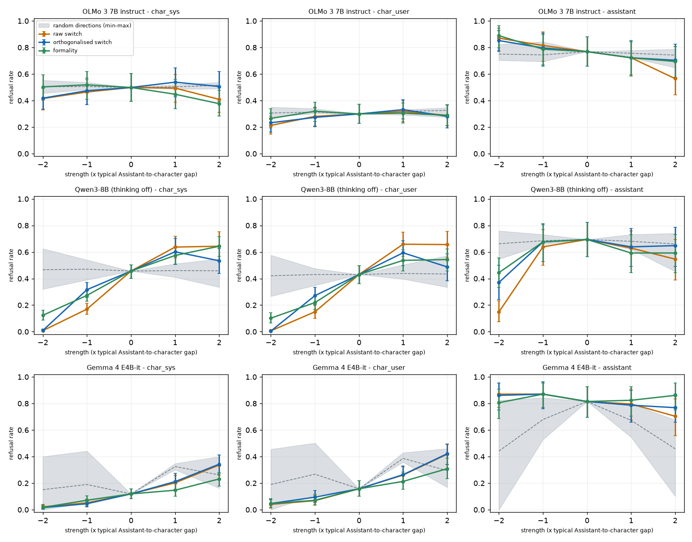

# Orthogonalised steering: does the switch minus formality still steer? (exploratory)

Design and pass rule were fixed in `docs/decisions.md` (2026-11-03) before running. Detector = the original regex (primary); the revised regex is a sensitivity check.

## Pass / fail (orthogonalised switch)

PASS = swing CI lower bound > 0.05 AND swing > the largest swing among the random directions AND the +2 minus -2 contrast has the sign of the raw switch's.

| model | set-up | orth swing [95% CI] | random swings (max, n seeds) | signed +2 - (-2) | result | same result with revised detector |
|---|---|---|---|---|---|---|
| OLMo 3 7B instruct | char_sys | 0.12 [0.07, 0.17] | 0.07 (n=6) | 0.09 [0.02, 0.15] | **FAIL** | PASS |
| OLMo 3 7B instruct | char_user | 0.10 [0.06, 0.13] | 0.08 (n=6) | 0.05 [0.01, 0.09] | **PASS** | PASS |
| Qwen3-8B (thinking off) | char_sys | 0.59 [0.50, 0.68] | 0.23 (n=6) | 0.52 [0.43, 0.62] | **PASS** | PASS |
| Qwen3-8B (thinking off) | char_user | 0.59 [0.49, 0.68] | 0.31 (n=6) | 0.48 [0.38, 0.58] | **PASS** | PASS |
| Gemma 4 E4B-it | char_sys | 0.33 [0.26, 0.40] | 0.39 (n=6) | 0.33 [0.26, 0.40] | **FAIL** | FAIL |
| Gemma 4 E4B-it | char_user | 0.37 [0.31, 0.44] | 0.41 (n=6) | 0.37 [0.31, 0.44] | **FAIL** | FAIL |

## Swings (highest minus lowest refusal rate across alpha = -2..+2), with 95% bootstrap CIs over the 36 requests

| model | set-up | raw switch | orthogonalised switch | formality | random: mean (min-max) | fraction of raw switch swing surviving orthogonalisation [CI] |
|---|---|---|---|---|---|---|
| OLMo 3 7B instruct | char_sys | 0.09 [0.06, 0.14] | 0.12 [0.07, 0.17] | 0.14 [0.09, 0.20] | 0.05 (0.01-0.07) | 1.34 [0.65, 2.13] |
| OLMo 3 7B instruct | char_user | 0.10 [0.06, 0.16] | 0.10 [0.06, 0.13] | 0.05 [0.03, 0.10] | 0.05 (0.03-0.08) | 0.94 [0.53, 1.73] |
| OLMo 3 7B instruct | assistant | 0.31 [0.19, 0.44] | 0.15 [0.07, 0.26] | 0.19 [0.12, 0.29] | 0.08 (0.04-0.12) | 0.48 [0.24, 1.04] |
| Qwen3-8B (thinking off) | char_sys | 0.64 [0.56, 0.74] | 0.59 [0.50, 0.68] | 0.52 [0.45, 0.59] | 0.15 (0.04-0.23) | 0.93 [0.73, 1.13] |
| Qwen3-8B (thinking off) | char_user | 0.65 [0.56, 0.75] | 0.59 [0.49, 0.68] | 0.44 [0.37, 0.53] | 0.13 (0.04-0.31) | 0.90 [0.71, 1.10] |
| Qwen3-8B (thinking off) | assistant | 0.55 [0.43, 0.68] | 0.32 [0.22, 0.47] | 0.25 [0.17, 0.36] | 0.13 (0.06-0.31) | 0.59 [0.39, 0.93] |
| Gemma 4 E4B-it | char_sys | 0.31 [0.24, 0.40] | 0.33 [0.26, 0.40] | 0.21 [0.17, 0.26] | 0.30 (0.20-0.39) | 1.04 [0.74, 1.46] |
| Gemma 4 E4B-it | char_user | 0.38 [0.30, 0.45] | 0.37 [0.31, 0.44] | 0.26 [0.20, 0.32] | 0.33 (0.20-0.41) | 0.99 [0.75, 1.30] |
| Gemma 4 E4B-it | assistant | 0.17 [0.08, 0.30] | 0.10 [0.06, 0.19] | 0.06 [0.05, 0.17] | 0.50 (0.21-0.81) | 0.61 [0.27, 1.67] |

## Dose-response curves (random band shaded)

Bars are 95% bootstrap CIs over requests; the grey band is the min-max over the random directions at each strength, the dashed line their mean.

### Refusal rates by strength

| model | set-up | direction | -2 | -1 | 0 | +1 | +2 |
|---|---|---|---|---|---|---|---|
| OLMo 3 7B instruct | char_sys | switch | 0.42 [0.33, 0.49] | 0.46 [0.37, 0.56] | 0.50 [0.40, 0.60] | 0.49 [0.39, 0.60] | 0.41 [0.31, 0.51] |
| OLMo 3 7B instruct | char_sys | orth | 0.42 [0.34, 0.49] | 0.47 [0.37, 0.57] | 0.50 [0.40, 0.60] | 0.54 [0.43, 0.65] | 0.51 [0.39, 0.62] |
| OLMo 3 7B instruct | char_sys | formality | 0.50 [0.40, 0.59] | 0.52 [0.41, 0.62] | 0.50 [0.40, 0.60] | 0.45 [0.34, 0.56] | 0.38 [0.28, 0.48] |
| OLMo 3 7B instruct | char_sys | random mean (min-max) | 0.50 (0.46-0.55) | 0.51 (0.48-0.54) | 0.50 (0.50-0.50) | 0.50 (0.49-0.52) | 0.51 (0.49-0.54) |
| OLMo 3 7B instruct | char_user | switch | 0.21 [0.15, 0.28] | 0.28 [0.21, 0.35] | 0.30 [0.23, 0.37] | 0.32 [0.24, 0.40] | 0.29 [0.21, 0.37] |
| OLMo 3 7B instruct | char_user | orth | 0.23 [0.16, 0.31] | 0.27 [0.20, 0.34] | 0.30 [0.23, 0.37] | 0.33 [0.26, 0.41] | 0.28 [0.19, 0.37] |
| OLMo 3 7B instruct | char_user | formality | 0.27 [0.19, 0.34] | 0.32 [0.24, 0.39] | 0.30 [0.23, 0.37] | 0.31 [0.23, 0.38] | 0.29 [0.21, 0.37] |
| OLMo 3 7B instruct | char_user | random mean (min-max) | 0.31 (0.27-0.35) | 0.31 (0.30-0.34) | 0.30 (0.30-0.30) | 0.32 (0.29-0.33) | 0.33 (0.27-0.35) |
| OLMo 3 7B instruct | assistant | switch | 0.87 [0.78, 0.94] | 0.81 [0.69, 0.92] | 0.77 [0.66, 0.88] | 0.72 [0.59, 0.84] | 0.56 [0.44, 0.69] |
| OLMo 3 7B instruct | assistant | orth | 0.85 [0.77, 0.93] | 0.80 [0.67, 0.91] | 0.77 [0.66, 0.88] | 0.72 [0.58, 0.84] | 0.70 [0.57, 0.82] |
| OLMo 3 7B instruct | assistant | formality | 0.89 [0.80, 0.96] | 0.79 [0.66, 0.90] | 0.77 [0.66, 0.88] | 0.72 [0.58, 0.85] | 0.69 [0.57, 0.81] |
| OLMo 3 7B instruct | assistant | random mean (min-max) | 0.75 (0.70-0.82) | 0.74 (0.69-0.84) | 0.77 (0.77-0.77) | 0.76 (0.72-0.78) | 0.74 (0.65-0.79) |
| Qwen3-8B (thinking off) | char_sys | switch | 0.01 [0.00, 0.02] | 0.17 [0.13, 0.21] | 0.46 [0.40, 0.50] | 0.64 [0.55, 0.72] | 0.64 [0.54, 0.75] |
| Qwen3-8B (thinking off) | char_sys | orth | 0.01 [0.00, 0.02] | 0.32 [0.26, 0.37] | 0.46 [0.40, 0.50] | 0.60 [0.51, 0.70] | 0.53 [0.44, 0.63] |
| Qwen3-8B (thinking off) | char_sys | formality | 0.12 [0.09, 0.16] | 0.27 [0.23, 0.32] | 0.46 [0.40, 0.50] | 0.57 [0.51, 0.64] | 0.64 [0.57, 0.71] |
| Qwen3-8B (thinking off) | char_sys | random mean (min-max) | 0.47 (0.32-0.62) | 0.47 (0.39-0.54) | 0.46 (0.46-0.46) | 0.46 (0.41-0.51) | 0.46 (0.33-0.55) |
| Qwen3-8B (thinking off) | char_user | switch | 0.01 [0.00, 0.01] | 0.15 [0.10, 0.20] | 0.43 [0.36, 0.50] | 0.66 [0.57, 0.75] | 0.66 [0.56, 0.75] |
| Qwen3-8B (thinking off) | char_user | orth | 0.00 [0.00, 0.01] | 0.27 [0.21, 0.33] | 0.43 [0.36, 0.50] | 0.59 [0.50, 0.69] | 0.49 [0.38, 0.58] |
| Qwen3-8B (thinking off) | char_user | formality | 0.10 [0.06, 0.14] | 0.22 [0.17, 0.27] | 0.43 [0.36, 0.50] | 0.54 [0.46, 0.62] | 0.54 [0.46, 0.62] |
| Qwen3-8B (thinking off) | char_user | random mean (min-max) | 0.42 (0.27-0.58) | 0.43 (0.35-0.48) | 0.43 (0.43-0.43) | 0.44 (0.40-0.50) | 0.43 (0.33-0.57) |
| Qwen3-8B (thinking off) | assistant | switch | 0.15 [0.07, 0.23] | 0.64 [0.50, 0.77] | 0.69 [0.56, 0.82] | 0.63 [0.49, 0.76] | 0.55 [0.39, 0.69] |
| Qwen3-8B (thinking off) | assistant | orth | 0.37 [0.24, 0.50] | 0.68 [0.53, 0.81] | 0.69 [0.56, 0.82] | 0.64 [0.49, 0.78] | 0.65 [0.49, 0.79] |
| Qwen3-8B (thinking off) | assistant | formality | 0.44 [0.33, 0.56] | 0.68 [0.53, 0.81] | 0.69 [0.56, 0.82] | 0.59 [0.44, 0.73] | 0.59 [0.44, 0.73] |
| Qwen3-8B (thinking off) | assistant | random mean (min-max) | 0.66 (0.55-0.76) | 0.69 (0.66-0.73) | 0.69 (0.69-0.69) | 0.68 (0.62-0.73) | 0.66 (0.45-0.74) |
| Gemma 4 E4B-it | char_sys | switch | 0.02 [0.01, 0.03] | 0.05 [0.03, 0.08] | 0.12 [0.08, 0.16] | 0.20 [0.15, 0.26] | 0.34 [0.26, 0.41] |
| Gemma 4 E4B-it | char_sys | orth | 0.02 [0.01, 0.03] | 0.04 [0.02, 0.07] | 0.12 [0.08, 0.16] | 0.21 [0.15, 0.27] | 0.34 [0.27, 0.41] |
| Gemma 4 E4B-it | char_sys | formality | 0.02 [0.00, 0.04] | 0.07 [0.04, 0.10] | 0.12 [0.08, 0.16] | 0.15 [0.10, 0.20] | 0.23 [0.18, 0.28] |
| Gemma 4 E4B-it | char_sys | random mean (min-max) | 0.15 (0.00-0.40) | 0.19 (0.05-0.44) | 0.12 (0.12-0.12) | 0.32 (0.30-0.35) | 0.26 (0.16-0.40) |
| Gemma 4 E4B-it | char_user | switch | 0.04 [0.01, 0.07] | 0.07 [0.03, 0.11] | 0.16 [0.10, 0.22] | 0.26 [0.20, 0.32] | 0.42 [0.34, 0.50] |
| Gemma 4 E4B-it | char_user | orth | 0.05 [0.02, 0.08] | 0.09 [0.05, 0.14] | 0.16 [0.10, 0.22] | 0.26 [0.20, 0.33] | 0.42 [0.34, 0.49] |
| Gemma 4 E4B-it | char_user | formality | 0.04 [0.02, 0.08] | 0.07 [0.04, 0.12] | 0.16 [0.10, 0.22] | 0.21 [0.15, 0.28] | 0.31 [0.23, 0.39] |
| Gemma 4 E4B-it | char_user | random mean (min-max) | 0.19 (0.00-0.46) | 0.27 (0.11-0.50) | 0.16 (0.16-0.16) | 0.39 (0.36-0.43) | 0.29 (0.17-0.46) |
| Gemma 4 E4B-it | assistant | switch | 0.87 [0.77, 0.95] | 0.87 [0.77, 0.95] | 0.81 [0.69, 0.93] | 0.80 [0.68, 0.91] | 0.70 [0.56, 0.83] |
| Gemma 4 E4B-it | assistant | orth | 0.86 [0.75, 0.95] | 0.87 [0.76, 0.96] | 0.81 [0.69, 0.93] | 0.79 [0.66, 0.90] | 0.77 [0.66, 0.87] |
| Gemma 4 E4B-it | assistant | formality | 0.81 [0.69, 0.91] | 0.87 [0.77, 0.95] | 0.81 [0.69, 0.93] | 0.82 [0.70, 0.93] | 0.86 [0.75, 0.95] |
| Gemma 4 E4B-it | assistant | random mean (min-max) | 0.44 (0.00-0.82) | 0.68 (0.53-0.84) | 0.81 (0.81-0.81) | 0.67 (0.55-0.80) | 0.46 (0.10-0.68) |

## Directions: cosines and held-out separation (steering layer)

| model | steering layer | cos(switch, formality) | cos(orth, switch) | cos(orth, formality) | switch AUC (held-out roles) | formality AUC (held-out instructions) | g (norm of Assistant-minus-character mean difference) |
|---|---|---|---|---|---|---|---|
| OLMo 3 7B instruct | 18 | +0.42 | +0.91 | -0.0000 | 0.89 | 1.00 | 3.1 |
| Qwen3-8B (thinking off) | 20 | +0.53 | +0.85 | -0.0000 | 0.98 | 1.00 | 25.9 |
| Gemma 4 E4B-it | 23 | +0.29 | +0.96 | -0.0000 | 1.00 | 1.00 | 11.0 |

All layers, cos(switch, formality):

| model | layer | cos(switch, formality) |
|---|---|---|
| OLMo 3 7B instruct | 13 | +0.43 |
| OLMo 3 7B instruct | 18 | +0.42 |
| OLMo 3 7B instruct | 22 | +0.33 |
| OLMo 3 7B instruct | 27 | +0.30 |
| Qwen3-8B (thinking off) | 14 | +0.53 |
| Qwen3-8B (thinking off) | 20 | +0.53 |
| Qwen3-8B (thinking off) | 25 | +0.43 |
| Qwen3-8B (thinking off) | 31 | +0.35 |
| Gemma 4 E4B-it | 17 | +0.46 |
| Gemma 4 E4B-it | 23 | +0.29 |
| Gemma 4 E4B-it | 29 | +0.26 |
| Gemma 4 E4B-it | 36 | +0.09 |

cos(orth, formality) is zero by construction (shown to confirm the projection). The held-out separation AUC is 0.5 for chance; the switch AUC uses held-out roles, the formality AUC held-out style instructions.

## Refusal-detector validation

300 existing replies (100 per model; request + first 220 characters shown to a blind labeller, fixed rubric: refuse / comply / unclear; labels R=146, C=136; unclear items dropped from agreement). Split by id: 150 development / 150 held-out.

| detector | development agreement (n) | held-out agreement (n) | all (n) |
|---|---|---|---|
| original regex (primary) | 0.893 (140) | 0.944 (142) | 0.918 (282) |
| revised regex (sensitivity; patterns written from the development half) | 0.943 (140) | 0.937 (142) | 0.940 (282) |

All disagreements of the original regex are misses (it never flagged a reply the labeller called compliance): assistant-style moralising without 'sorry/can't' and soft in-character refusals. So absolute refusal rates are biased low; the revision fixed the development half but not the held-out half, so the original stays primary and the revision is reported as a sensitivity check (column above).

## Flags and oddities

- **FLAG** OLMo 3 7B instruct: the orthogonalised switch moves the plain Assistant's refusal by 0.15, at least 0.8 x its swing on char_sys characters (0.12): possible general refusal lever, not persona-specific.
- **FLAG** OLMo 3 7B instruct: the orthogonalised switch moves the plain Assistant's refusal by 0.15, at least 0.8 x its swing on char_user characters (0.10): possible general refusal lever, not persona-specific.
- Qwen3-8B (thinking off): orth swing on the plain Assistant 0.32 vs 0.59 on char_sys characters (no flag).
- Qwen3-8B (thinking off): orth swing on the plain Assistant 0.32 vs 0.59 on char_user characters (no flag).
- Gemma 4 E4B-it: orth swing on the plain Assistant 0.10 vs 0.33 on char_sys characters (no flag).
- Gemma 4 E4B-it: orth swing on the plain Assistant 0.10 vs 0.37 on char_user characters (no flag).

Degenerate replies (shorter than 20 characters or under 50% alphabetic) by direction and strength, as a coherence check:

| model | direction | -2 | -1 | +1 | +2 |
|---|---|---|---|---|---|
| Gemma 4 E4B-it | formality | 0.000 | 0.000 | 0.000 | 0.000 |
| Gemma 4 E4B-it | orth | 0.000 | 0.000 | 0.000 | 0.000 |
| Gemma 4 E4B-it | random | 0.022 | 0.003 | 0.009 | 0.022 |
| Gemma 4 E4B-it | switch | 0.000 | 0.000 | 0.000 | 0.000 |
| OLMo 3 7B instruct | formality | 0.000 | 0.000 | 0.000 | 0.000 |
| OLMo 3 7B instruct | orth | 0.000 | 0.000 | 0.000 | 0.000 |
| OLMo 3 7B instruct | random | 0.000 | 0.000 | 0.000 | 0.000 |
| OLMo 3 7B instruct | switch | 0.000 | 0.000 | 0.000 | 0.000 |
| Qwen3-8B (thinking off) | formality | 0.000 | 0.000 | 0.000 | 0.000 |
| Qwen3-8B (thinking off) | orth | 0.001 | 0.001 | 0.000 | 0.000 |
| Qwen3-8B (thinking off) | random | 0.000 | 0.000 | 0.001 | 0.000 |
| Qwen3-8B (thinking off) | switch | 0.000 | 0.001 | 0.000 | 0.000 |

Rates by role group for the orthogonalised switch (helpful vs stylized roles), swing:

| model | set-up | helpful | stylized |
|---|---|---|---|
| OLMo 3 7B instruct | char_sys | 0.17 [0.10, 0.25] | 0.31 [0.21, 0.42] |
| OLMo 3 7B instruct | char_user | 0.17 [0.11, 0.25] | 0.11 [0.05, 0.19] |
| Qwen3-8B (thinking off) | char_sys | 0.85 [0.76, 0.92] | 0.45 [0.35, 0.56] |
| Qwen3-8B (thinking off) | char_user | 0.80 [0.70, 0.90] | 0.41 [0.31, 0.53] |
| Gemma 4 E4B-it | char_sys | 0.54 [0.44, 0.64] | 0.11 [0.07, 0.16] |
| Gemma 4 E4B-it | char_user | 0.54 [0.44, 0.64] | 0.21 [0.15, 0.27] |
