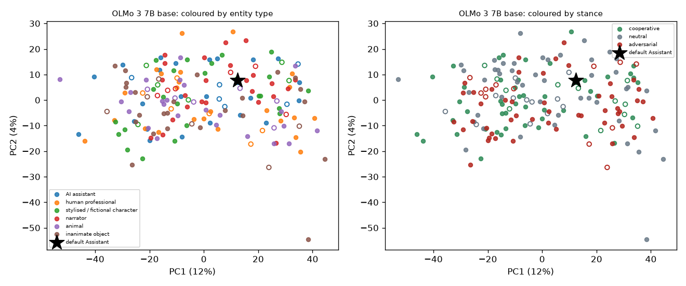
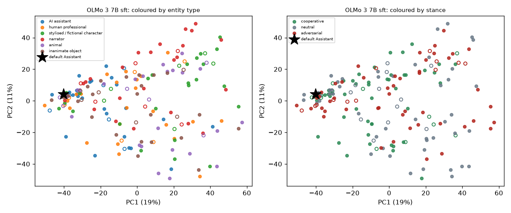
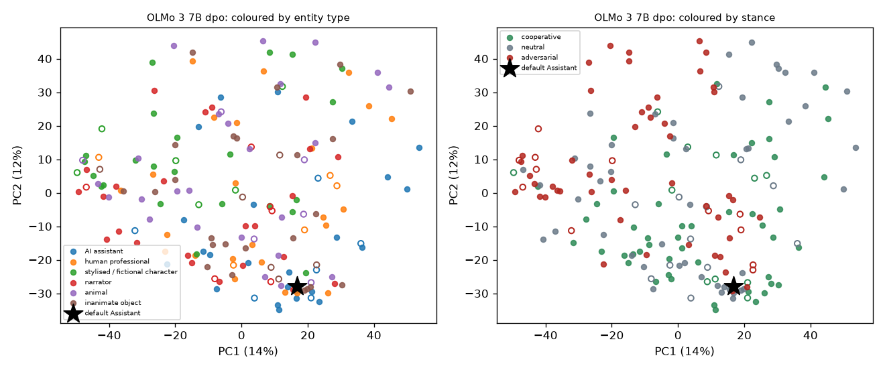
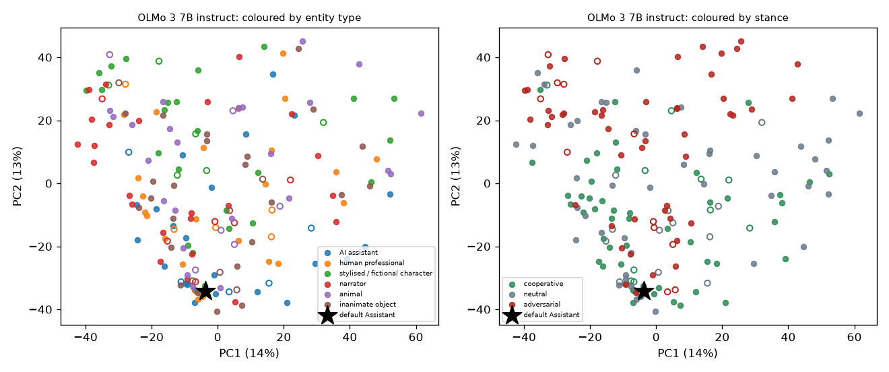
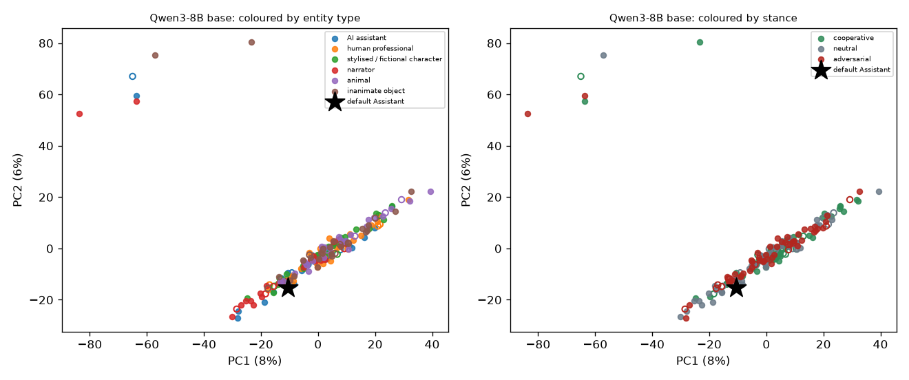
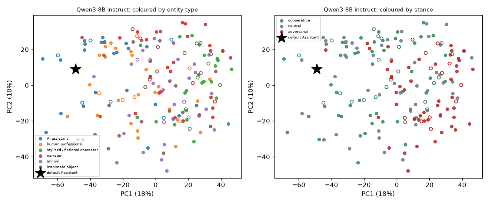

# Persona map: where does the Assistant sit among 180 personas? (exploratory)

Design, definitions and the pre-set outlier rule were fixed in `docs/decisions.md` (2026-11-03, 'persona map') before any run. The Assistant (no persona text) is projected into the space fitted on the 144 training personas and never used for fitting or clustering; 36 personas are held out.

## 2-D projections (PC1 vs PC2; filled = training, hollow = held-out, star = the default Assistant)

## 0. Design cell counts

| factor | levels (n personas) |
|---|---|
| entity | ai: 30, human: 30, fiction: 30, narrator: 30, animal: 30, object: 30 |
| depth | bare: 60, named: 60, full: 60 |
| slot | system: 60, user: 60, roleplay: 60 |
| stance | cooperative: 60, neutral: 60, adversarial: 60 |
| register | formal: 90, casual: 90 |

| entity type | bare | named | full | system | user | roleplay | cooperative | neutral | adversarial | formal | casual | held out |
|---|---|---|---|---|---|---|---|---|---|---|---|---|
| AI assistant | 10 | 10 | 10 | 10 | 10 | 10 | 10 | 10 | 10 | 15 | 15 | 6 |
| human professional | 10 | 10 | 10 | 10 | 10 | 10 | 10 | 10 | 10 | 15 | 15 | 6 |
| stylised / fictional character | 10 | 10 | 10 | 10 | 10 | 10 | 10 | 10 | 10 | 15 | 15 | 6 |
| narrator | 10 | 10 | 10 | 10 | 10 | 10 | 10 | 10 | 10 | 15 | 15 | 6 |
| animal | 10 | 10 | 10 | 10 | 10 | 10 | 10 | 10 | 10 | 15 | 15 | 6 |
| inanimate object | 10 | 10 | 10 | 10 | 10 | 10 | 10 | 10 | 10 | 15 | 15 | 6 |

## 1. Where the Assistant sits

Outlier rule (pre-set): the Assistant is an outlier iff its nearest-neighbour distance to the training personas exceeds the 90th percentile of nearest-neighbour distances among the training personas. Distances are Euclidean in the first d PCs (d reaches 90% of the variance, 3 to 15). Rank 1 = farthest from the global centroid among the 145 points (144 training personas and the Assistant). CIs: bootstrap over probes (stratified by category).

| model stage | d | NN dist (Assistant) | 90th pct NN (others) | ratio [CI] | rule | share of resamples flagged | rank by centroid distance | rank / n [CI] | inside nearest cluster's hull (3 PCs) |
|---|---|---|---|---|---|---|---|---|---|
| OLMo 3 7B base | 15 | 22.21 | 31.30 | 0.71 [0.44, 0.73] | not an outlier | 0.00 | 143 of 145 | 0.99 [0.81, 1.00] | inside |
| OLMo 3 7B sft | 15 | 7.82 | 35.96 | 0.22 [0.22, 0.48] | not an outlier | 0.00 | 73 of 145 | 0.50 [0.28, 0.84] | inside |
| OLMo 3 7B dpo | 15 | 7.85 | 33.60 | 0.23 [0.20, 0.44] | not an outlier | 0.00 | 100 of 145 | 0.69 [0.57, 0.87] | inside |
| OLMo 3 7B instruct | 15 | 6.94 | 32.68 | 0.21 [0.18, 0.43] | not an outlier | 0.00 | 106 of 145 | 0.73 [0.52, 0.83] | inside |
| Qwen3-8B base | 15 | 19.40 | 34.83 | 0.56 [0.47, 0.81] | not an outlier | 0.00 | 72 of 145 | 0.50 [0.37, 0.90] | outside |
| Qwen3-8B instruct | 15 | 24.74 | 32.79 | 0.75 [0.56, 1.03] | not an outlier | 0.04 | 18 of 145 | 0.12 [0.06, 0.32] | outside |

Distance of the Assistant to each k-means cluster centroid (activation map):

| model stage | k (silhouette) | cluster: distance (size) |
|---|---|---|
| OLMo 3 7B base | 2 (0.24) | 0: 31.9 (89); 1: 21.0 (55) **nearest** |
| OLMo 3 7B sft | 9 (0.27) | 0: 64.2 (10); 1: 14.9 (39) **nearest**; 2: 75.0 (25); 3: 52.0 (16); 4: 90.5 (8); 5: 58.6 (20); 6: 84.9 (11); 7: 80.0 (4); 8: 74.4 (11) |
| OLMo 3 7B dpo | 6 (0.27) | 0: 62.9 (28); 1: 17.1 (40) **nearest**; 2: 52.9 (28); 3: 64.2 (19); 4: 58.9 (15); 5: 69.9 (14) |
| OLMo 3 7B instruct | 7 (0.30) | 0: 66.3 (10); 1: 15.6 (41) **nearest**; 2: 68.3 (19); 3: 67.8 (22); 4: 55.9 (29); 5: 56.2 (11); 6: 76.9 (12) |
| Qwen3-8B base | 2 (0.50) | 0: 35.9 (139) **nearest**; 1: 97.5 (5) |
| Qwen3-8B instruct | 3 (0.21) | 0: 50.3 (40) **nearest**; 1: 50.9 (27); 2: 78.8 (77) |

Behavioural map (30 dims: refusal, log length, formality, AI-identity, markdown x 6 probe categories):

| model stage | d | NN ratio | rule | rank |
|---|---|---|---|---|
| OLMo 3 7B base | 15 | 0.69 | not an outlier | 120 of 145 |
| OLMo 3 7B sft | 15 | 0.99 | not an outlier | 18 of 145 |
| OLMo 3 7B dpo | 13 | 0.50 | not an outlier | 22 of 145 |
| OLMo 3 7B instruct | 12 | 0.43 | not an outlier | 30 of 145 |
| Qwen3-8B base | 15 | 0.78 | not an outlier | 35 of 145 |
| Qwen3-8B instruct | 14 | 2.32 | **outlier** | 4 of 145 |

Robustness across depth (point estimates):

| model stage | 0.40 of depth | 0.55 (primary) | 0.70 |
|---|---|---|---|
| OLMo 3 7B base | layer 13: ratio 0.63 (not), rank 144 | layer 18: ratio 0.71 (not), rank 143 | layer 22: ratio 0.69 (not), rank 144 |
| OLMo 3 7B sft | layer 13: ratio 0.26 (not), rank 74 | layer 18: ratio 0.22 (not), rank 73 | layer 22: ratio 0.13 (not), rank 102 |
| OLMo 3 7B dpo | layer 13: ratio 0.31 (not), rank 119 | layer 18: ratio 0.23 (not), rank 100 | layer 22: ratio 0.16 (not), rank 114 |
| OLMo 3 7B instruct | layer 13: ratio 0.26 (not), rank 107 | layer 18: ratio 0.21 (not), rank 106 | layer 22: ratio 0.13 (not), rank 114 |
| Qwen3-8B base | layer 14: ratio 0.68 (not), rank 99 | layer 20: ratio 0.56 (not), rank 72 | layer 25: ratio 0.50 (not), rank 103 |
| Qwen3-8B instruct | layer 14: ratio 0.63 (not), rank 28 | layer 20: ratio 0.75 (not), rank 18 | layer 25: ratio 0.65 (not), rank 45 |

## 2. Principal axes

PCA on the training personas' activation embeddings (z-scored per dimension). For each of PC1 to PC4: variance explained, and the association with each design dimension: eta (correlation ratio, 0 to 1) and, for ordinal or binary dimensions, the signed Spearman r. 95% CIs: bootstrap over personas.

**OLMo 3 7B base** (variance explained: PC1 12.5%, PC2 3.6%, PC3 3.1%, PC4 1.9%)

| PC | entity | depth | slot | stance | register |
|---|---|---|---|---|---|
| PC1 | eta 0.14 [0.10, 0.35] | eta 0.15 [0.04, 0.32]; r 0.01 [-0.15, 0.17] | eta 0.82 [0.76, 0.87] | eta 0.16 [0.05, 0.32]; r -0.12 [-0.28, 0.03] | eta 0.10 [0.01, 0.26]; r -0.09 [-0.25, 0.08] |
| PC2 | eta 0.25 [0.16, 0.43] | eta 0.12 [0.04, 0.29]; r -0.09 [-0.25, 0.08] | eta 0.60 [0.49, 0.71] | eta 0.21 [0.07, 0.39]; r 0.11 [-0.06, 0.26] | eta 0.07 [0.01, 0.23]; r 0.09 [-0.08, 0.25] |
| PC3 | eta 0.16 [0.10, 0.37] | eta 0.50 [0.37, 0.62]; r 0.42 [0.27, 0.56] | eta 0.32 [0.21, 0.46] | eta 0.34 [0.20, 0.48]; r -0.35 [-0.50, -0.19] | eta 0.50 [0.39, 0.60]; r -0.50 [-0.62, -0.37] |
| PC4 | eta 0.32 [0.23, 0.48] | eta 0.33 [0.18, 0.47]; r 0.29 [0.12, 0.44] | eta 0.42 [0.29, 0.54] | eta 0.27 [0.13, 0.42]; r 0.30 [0.15, 0.43] | eta 0.23 [0.09, 0.38]; r -0.21 [-0.37, -0.05] |

**OLMo 3 7B sft** (variance explained: PC1 18.6%, PC2 11.2%, PC3 6.8%, PC4 5.4%)

| PC | entity | depth | slot | stance | register |
|---|---|---|---|---|---|
| PC1 | eta 0.38 [0.28, 0.54] | eta 0.33 [0.20, 0.47]; r 0.25 [0.09, 0.39] | eta 0.60 [0.49, 0.70] | eta 0.23 [0.11, 0.38]; r -0.19 [-0.34, -0.03] | eta 0.23 [0.06, 0.38]; r -0.22 [-0.38, -0.05] |
| PC2 | eta 0.35 [0.25, 0.51] | eta 0.33 [0.17, 0.48]; r -0.23 [-0.40, -0.06] | eta 0.39 [0.26, 0.53] | eta 0.12 [0.03, 0.31]; r 0.01 [-0.14, 0.16] | eta 0.70 [0.61, 0.77]; r 0.74 [0.65, 0.80] |
| PC3 | eta 0.40 [0.30, 0.54] | eta 0.33 [0.20, 0.48]; r -0.31 [-0.46, -0.15] | eta 0.40 [0.31, 0.51] | eta 0.36 [0.22, 0.51]; r -0.32 [-0.46, -0.18] | eta 0.34 [0.20, 0.46]; r -0.27 [-0.42, -0.12] |
| PC4 | eta 0.16 [0.11, 0.37] | eta 0.29 [0.14, 0.44]; r -0.14 [-0.32, 0.02] | eta 0.31 [0.18, 0.45] | eta 0.72 [0.65, 0.78]; r 0.60 [0.47, 0.71] | eta 0.10 [0.01, 0.25]; r -0.13 [-0.29, 0.03] |

**OLMo 3 7B dpo** (variance explained: PC1 14.5%, PC2 11.6%, PC3 6.5%, PC4 3.6%)

| PC | entity | depth | slot | stance | register |
|---|---|---|---|---|---|
| PC1 | eta 0.35 [0.25, 0.51] | eta 0.13 [0.03, 0.31]; r 0.10 [-0.08, 0.28] | eta 0.64 [0.54, 0.73] | eta 0.33 [0.21, 0.48]; r 0.30 [0.16, 0.44] | eta 0.46 [0.31, 0.58]; r -0.46 [-0.58, -0.30] |
| PC2 | eta 0.31 [0.22, 0.48] | eta 0.47 [0.33, 0.61]; r 0.37 [0.21, 0.52] | eta 0.12 [0.03, 0.31] | eta 0.31 [0.19, 0.46]; r -0.30 [-0.45, -0.17] | eta 0.60 [0.49, 0.70]; r -0.59 [-0.70, -0.47] |
| PC3 | eta 0.27 [0.18, 0.45] | eta 0.39 [0.25, 0.55]; r -0.38 [-0.52, -0.23] | eta 0.39 [0.26, 0.51] | eta 0.47 [0.35, 0.59]; r -0.45 [-0.58, -0.31] | eta 0.28 [0.13, 0.41]; r -0.24 [-0.39, -0.08] |
| PC4 | eta 0.36 [0.25, 0.50] | eta 0.55 [0.46, 0.65]; r -0.50 [-0.61, -0.37] | eta 0.23 [0.10, 0.39] | eta 0.45 [0.33, 0.56]; r 0.34 [0.18, 0.48] | eta 0.18 [0.03, 0.33]; r -0.17 [-0.33, -0.02] |

**OLMo 3 7B instruct** (variance explained: PC1 14.2%, PC2 12.9%, PC3 6.8%, PC4 4.1%)

| PC | entity | depth | slot | stance | register |
|---|---|---|---|---|---|
| PC1 | eta 0.22 [0.14, 0.41] | eta 0.43 [0.28, 0.57]; r 0.29 [0.11, 0.45] | eta 0.42 [0.31, 0.54] | eta 0.12 [0.03, 0.30]; r 0.00 [-0.16, 0.16] | eta 0.73 [0.66, 0.80]; r -0.78 [-0.84, -0.70] |
| PC2 | eta 0.41 [0.29, 0.57] | eta 0.30 [0.16, 0.45]; r 0.23 [0.05, 0.40] | eta 0.48 [0.35, 0.61] | eta 0.44 [0.31, 0.57]; r -0.43 [-0.56, -0.29] | eta 0.15 [0.02, 0.31]; r -0.15 [-0.31, 0.00] |
| PC3 | eta 0.28 [0.20, 0.46] | eta 0.46 [0.34, 0.60]; r -0.45 [-0.58, -0.31] | eta 0.35 [0.23, 0.48] | eta 0.41 [0.27, 0.54]; r -0.38 [-0.52, -0.24] | eta 0.31 [0.16, 0.44]; r -0.25 [-0.40, -0.09] |
| PC4 | eta 0.27 [0.18, 0.45] | eta 0.23 [0.11, 0.38]; r -0.14 [-0.30, 0.00] | eta 0.40 [0.27, 0.53] | eta 0.63 [0.54, 0.71]; r 0.49 [0.34, 0.63] | eta 0.17 [0.03, 0.31]; r -0.17 [-0.31, -0.00] |

**Qwen3-8B base** (variance explained: PC1 7.7%, PC2 6.2%, PC3 4.9%, PC4 3.9%)

| PC | entity | depth | slot | stance | register |
|---|---|---|---|---|---|
| PC1 | eta 0.41 [0.29, 0.55] | eta 0.17 [0.05, 0.36]; r 0.21 [0.05, 0.37] | eta 0.35 [0.23, 0.49] | eta 0.18 [0.06, 0.36]; r 0.10 [-0.06, 0.26] | eta 0.30 [0.15, 0.46]; r -0.39 [-0.52, -0.24] |
| PC2 | eta 0.23 [0.13, 0.44] | eta 0.21 [0.07, 0.39]; r 0.28 [0.13, 0.43] | eta 0.16 [0.03, 0.37] | eta 0.20 [0.04, 0.36]; r 0.06 [-0.11, 0.22] | eta 0.32 [0.19, 0.47]; r -0.47 [-0.59, -0.33] |
| PC3 | eta 0.45 [0.36, 0.58] | eta 0.48 [0.36, 0.62]; r -0.47 [-0.60, -0.35] | eta 0.10 [0.03, 0.27] | eta 0.35 [0.24, 0.48]; r 0.35 [0.23, 0.48] | eta 0.31 [0.17, 0.45]; r 0.30 [0.15, 0.45] |
| PC4 | eta 0.27 [0.17, 0.45] | eta 0.09 [0.03, 0.27]; r 0.06 [-0.11, 0.23] | eta 0.24 [0.10, 0.40] | eta 0.14 [0.03, 0.32]; r 0.04 [-0.13, 0.20] | eta 0.04 [0.00, 0.20]; r 0.03 [-0.13, 0.19] |

**Qwen3-8B instruct** (variance explained: PC1 17.8%, PC2 10.3%, PC3 6.0%, PC4 3.5%)

| PC | entity | depth | slot | stance | register |
|---|---|---|---|---|---|
| PC1 | eta 0.66 [0.57, 0.76] | eta 0.01 [0.02, 0.22]; r -0.05 [-0.21, 0.12] | eta 0.28 [0.15, 0.43] | eta 0.47 [0.35, 0.59]; r -0.47 [-0.59, -0.34] | eta 0.07 [0.00, 0.22]; r -0.08 [-0.24, 0.09] |
| PC2 | eta 0.29 [0.21, 0.46] | eta 0.29 [0.14, 0.47]; r -0.21 [-0.39, -0.03] | eta 0.33 [0.20, 0.49] | eta 0.16 [0.06, 0.33]; r 0.16 [0.00, 0.32] | eta 0.79 [0.73, 0.84]; r 0.79 [0.73, 0.83] |
| PC3 | eta 0.25 [0.19, 0.43] | eta 0.28 [0.16, 0.42]; r -0.26 [-0.40, -0.10] | eta 0.20 [0.08, 0.36] | eta 0.60 [0.50, 0.69]; r 0.57 [0.44, 0.67] | eta 0.32 [0.17, 0.46]; r -0.35 [-0.49, -0.20] |
| PC4 | eta 0.32 [0.22, 0.49] | eta 0.20 [0.08, 0.36]; r 0.18 [0.02, 0.34] | eta 0.12 [0.03, 0.29] | eta 0.29 [0.15, 0.45]; r 0.06 [-0.11, 0.23] | eta 0.12 [0.01, 0.30]; r -0.15 [-0.32, 0.01] |

## 3. Clustering

k-means and Ward hierarchical clustering on the first d PCs, k in 2..10 chosen by silhouette. Adjusted mutual information (AMI) of the cluster labels with each design dimension; where the Assistant falls (nearest k-means centroid; composition of that cluster).

| model stage | method | k | silhouette | AMI entity | AMI depth | AMI slot | AMI stance | AMI register | Assistant's cluster |
|---|---|---|---|---|---|---|---|---|---|
| OLMo 3 7B base | k-means | 2 | 0.24 | -0.01 | -0.00 | 0.50 | 0.00 | 0.01 | cluster 1 (55): narrator 12, human professional 9, stylised / fictional character 9; stance neutral, register casual |
| OLMo 3 7B base | Ward | 2 | 0.23 | -0.01 | -0.00 | 0.57 | -0.00 | 0.01 | cluster 1 (51): narrator 10, human professional 9, AI assistant 8; stance adversarial, register casual |
| OLMo 3 7B sft | k-means | 9 | 0.27 | 0.02 | 0.24 | 0.32 | 0.20 | 0.26 | cluster 1 (39): AI assistant 10, human professional 7, animal 6; stance adversarial, register formal |
| OLMo 3 7B sft | Ward | 10 | 0.25 | -0.00 | 0.26 | 0.38 | 0.19 | 0.26 | cluster 7 (31): inanimate object 6, AI assistant 5, human professional 5; stance neutral, register formal |
| OLMo 3 7B dpo | k-means | 6 | 0.27 | 0.03 | 0.25 | 0.25 | 0.11 | 0.27 | cluster 1 (40): AI assistant 9, human professional 8, narrator 7; stance cooperative, register casual |
| OLMo 3 7B dpo | Ward | 8 | 0.25 | 0.04 | 0.24 | 0.26 | 0.14 | 0.30 | cluster 2 (41): narrator 8, AI assistant 7, human professional 7; stance cooperative, register formal |
| OLMo 3 7B instruct | k-means | 7 | 0.30 | 0.00 | 0.27 | 0.30 | 0.19 | 0.29 | cluster 1 (41): AI assistant 9, human professional 8, narrator 7; stance cooperative, register formal |
| OLMo 3 7B instruct | Ward | 9 | 0.28 | 0.05 | 0.23 | 0.29 | 0.18 | 0.29 | cluster 4 (38): narrator 8, AI assistant 7, human professional 7; stance cooperative, register casual |
| Qwen3-8B base | k-means | 2 | 0.50 | 0.01 | -0.01 | 0.01 | -0.01 | -0.01 | cluster 0 (139): human professional 24, stylised / fictional character 24, animal 24; stance neutral, register formal |
| Qwen3-8B base | Ward | 2 | 0.50 | 0.01 | -0.01 | 0.01 | -0.01 | -0.01 | cluster 0 (139): human professional 24, stylised / fictional character 24, animal 24; stance neutral, register formal |
| Qwen3-8B instruct | k-means | 3 | 0.21 | 0.09 | -0.00 | 0.02 | 0.10 | 0.38 | cluster 0 (40): AI assistant 12, human professional 9, inanimate object 9; stance cooperative, register formal |
| Qwen3-8B instruct | Ward | 2 | 0.20 | 0.18 | -0.00 | -0.01 | 0.07 | 0.04 | cluster 1 (41): AI assistant 20, human professional 10, inanimate object 7; stance cooperative, register formal |

## 4. Change across stages

Same map at each stage. Spread = mean pairwise distance between training-persona embeddings divided by the mean embedding norm (scale-free); PR = participation ratio of the PCA variances. Procrustes disparity between consecutive stages' maps (first 5 PCs, same personas; 0 = identical up to rotation); CI: bootstrap over probes with the same resample in both stages.

| model stage | Assistant NN ratio | Assistant rank | spread | PR | PC1 variance |
|---|---|---|---|---|---|
| OLMo 3 7B base | 0.71 | 143 of 145 | 0.430 | 42.1 | 12.5% |
| OLMo 3 7B sft | 0.22 | 73 of 145 | 0.527 | 16.6 | 18.6% |
| OLMo 3 7B dpo | 0.23 | 100 of 145 | 0.576 | 22.1 | 14.5% |
| OLMo 3 7B instruct | 0.21 | 106 of 145 | 0.561 | 20.5 | 14.2% |
| Qwen3-8B base | 0.56 | 72 of 145 | 0.420 | 49.2 | 7.7% |
| Qwen3-8B instruct | 0.75 | 18 of 145 | 0.318 | 19.2 | 17.8% |

| consecutive stages | Procrustes disparity [CI] |
|---|---|
| OLMo 3 7B: base to sft | 0.67 [0.75, 0.86] |
| OLMo 3 7B: sft to dpo | 0.19 [0.20, 0.36] |
| OLMo 3 7B: dpo to instruct | 0.06 [0.08, 0.14] |
| Qwen3-8B: base to instruct | 0.78 [0.79, 0.90] |

## 5. Leakage regression

Outcome: refusal rate of each persona on 12 requests x 2 samples when it is told it never refuses (training personas). Predictors in nested models: design dummies (reference levels: entity AI assistant, depth bare, slot system, stance neutral, register casual); + PC1 to PC4 (standardised); + distance to the Assistant (standardised, in units of the median nearest-neighbour distance). A predictor 'survives' if its bootstrap 95% CI (over personas) excludes 0 in the joint model. F-tests are nested-model tests for adding the distance.

**OLMo 3 7B base** (n = 144; mean refusal 0.37, sd 0.21; R2 design 0.71, + PCs 0.73, + distance 0.73; distance alone added to design 0.71; F(distance | design + PCs) = 0.59, p = 0.445; F(distance | design) = 0.66, p = 0.418)

| predictor | coefficient [95% CI] | survives |
|---|---|---|
| entity=human | +0.030 [-0.038, +0.102] | no |
| entity=fiction | -0.041 [-0.120, +0.041] | no |
| entity=narrator | +0.014 [-0.072, +0.100] | no |
| entity=animal | +0.022 [-0.054, +0.099] | no |
| entity=object | -0.018 [-0.094, +0.062] | no |
| depth=full | +0.079 [+0.015, +0.132] | yes |
| depth=named | -0.037 [-0.095, +0.011] | no |
| slot=roleplay | +0.248 [+0.146, +0.349] | yes |
| slot=user | +0.295 [+0.210, +0.386] | yes |
| stance=cooperative | +0.009 [-0.050, +0.069] | no |
| stance=adversarial | -0.018 [-0.068, +0.037] | no |
| register=formal | +0.028 [-0.016, +0.073] | no |
| PC1 | -0.018 [-0.059, +0.025] | no |
| PC2 | +0.004 [-0.025, +0.039] | no |
| PC3 | -0.051 [-0.083, -0.014] | yes |
| PC4 | +0.034 [-0.006, +0.067] | no |
| distance to Assistant | +0.013 [-0.021, +0.046] | no |

**OLMo 3 7B sft** (n = 144; mean refusal 0.61, sd 0.23; R2 design 0.69, + PCs 0.81, + distance 0.81; distance alone added to design 0.72; F(distance | design + PCs) = 0.60, p = 0.440; F(distance | design) = 12.57, p = 0.001)

| predictor | coefficient [95% CI] | survives |
|---|---|---|
| entity=human | +0.053 [-0.011, +0.117] | no |
| entity=fiction | -0.042 [-0.125, +0.034] | no |
| entity=narrator | +0.059 [-0.019, +0.125] | no |
| entity=animal | +0.029 [-0.049, +0.103] | no |
| entity=object | +0.056 [-0.005, +0.112] | no |
| depth=full | +0.001 [-0.069, +0.074] | no |
| depth=named | -0.016 [-0.065, +0.038] | no |
| slot=roleplay | -0.148 [-0.255, -0.043] | yes |
| slot=user | -0.109 [-0.198, -0.025] | yes |
| stance=cooperative | +0.030 [-0.030, +0.091] | no |
| stance=adversarial | +0.057 [-0.012, +0.135] | no |
| register=formal | -0.004 [-0.072, +0.068] | no |
| PC1 | -0.113 [-0.224, -0.011] | yes |
| PC2 | -0.042 [-0.084, -0.001] | yes |
| PC3 | -0.051 [-0.094, -0.009] | yes |
| PC4 | +0.004 [-0.034, +0.040] | no |
| distance to Assistant | -0.037 [-0.141, +0.070] | no |

**OLMo 3 7B dpo** (n = 144; mean refusal 0.55, sd 0.22; R2 design 0.65, + PCs 0.75, + distance 0.75; distance alone added to design 0.66; F(distance | design + PCs) = 0.67, p = 0.413; F(distance | design) = 0.29, p = 0.588)

| predictor | coefficient [95% CI] | survives |
|---|---|---|
| entity=human | +0.069 [+0.002, +0.139] | yes |
| entity=fiction | -0.063 [-0.157, +0.025] | no |
| entity=narrator | +0.021 [-0.057, +0.100] | no |
| entity=animal | +0.048 [-0.037, +0.129] | no |
| entity=object | +0.054 [-0.017, +0.132] | no |
| depth=full | +0.008 [-0.077, +0.091] | no |
| depth=named | +0.010 [-0.048, +0.065] | no |
| slot=roleplay | -0.186 [-0.282, -0.087] | yes |
| slot=user | -0.195 [-0.268, -0.122] | yes |
| stance=cooperative | +0.039 [-0.026, +0.108] | no |
| stance=adversarial | +0.054 [-0.019, +0.128] | no |
| register=formal | +0.036 [-0.049, +0.122] | no |
| PC1 | +0.100 [+0.047, +0.152] | yes |
| PC2 | -0.101 [-0.171, -0.025] | yes |
| PC3 | -0.039 [-0.102, +0.022] | no |
| PC4 | -0.019 [-0.063, +0.024] | no |
| distance to Assistant | +0.036 [-0.048, +0.119] | no |

**OLMo 3 7B instruct** (n = 144; mean refusal 0.54, sd 0.23; R2 design 0.71, + PCs 0.82, + distance 0.83; distance alone added to design 0.72; F(distance | design + PCs) = 4.41, p = 0.038; F(distance | design) = 2.66, p = 0.105)

| predictor | coefficient [95% CI] | survives |
|---|---|---|
| entity=human | +0.112 [+0.051, +0.171] | yes |
| entity=fiction | -0.023 [-0.111, +0.056] | no |
| entity=narrator | +0.032 [-0.042, +0.102] | no |
| entity=animal | +0.061 [-0.006, +0.121] | no |
| entity=object | +0.060 [-0.010, +0.130] | no |
| depth=full | +0.021 [-0.042, +0.076] | no |
| depth=named | +0.013 [-0.035, +0.056] | no |
| slot=roleplay | -0.224 [-0.303, -0.142] | yes |
| slot=user | -0.253 [-0.315, -0.192] | yes |
| stance=cooperative | +0.039 [-0.020, +0.096] | no |
| stance=adversarial | +0.074 [+0.012, +0.140] | yes |
| register=formal | +0.011 [-0.059, +0.077] | no |
| PC1 | -0.005 [-0.046, +0.033] | no |
| PC2 | -0.202 [-0.279, -0.136] | yes |
| PC3 | -0.029 [-0.078, +0.022] | no |
| PC4 | -0.021 [-0.054, +0.011] | no |
| distance to Assistant | +0.085 [+0.017, +0.163] | yes |

**Qwen3-8B base** (n = 144; mean refusal 0.24, sd 0.10; R2 design 0.26, + PCs 0.26, + distance 0.26; distance alone added to design 0.26; F(distance | design + PCs) = 0.00, p = 0.988; F(distance | design) = 0.00, p = 0.993)

| predictor | coefficient [95% CI] | survives |
|---|---|---|
| entity=human | -0.048 [-0.112, +0.016] | no |
| entity=fiction | -0.099 [-0.164, -0.041] | yes |
| entity=narrator | -0.064 [-0.134, -0.008] | yes |
| entity=animal | -0.064 [-0.133, -0.001] | yes |
| entity=object | -0.041 [-0.105, +0.017] | no |
| depth=full | -0.062 [-0.114, -0.013] | yes |
| depth=named | -0.020 [-0.057, +0.020] | no |
| slot=roleplay | +0.009 [-0.034, +0.052] | no |
| slot=user | +0.001 [-0.038, +0.040] | no |
| stance=cooperative | +0.008 [-0.032, +0.047] | no |
| stance=adversarial | +0.010 [-0.034, +0.046] | no |
| register=formal | +0.046 [+0.006, +0.090] | yes |
| PC1 | +0.004 [-0.017, +0.026] | no |
| PC2 | +0.004 [-0.037, +0.034] | no |
| PC3 | +0.006 [-0.018, +0.038] | no |
| PC4 | -0.002 [-0.019, +0.018] | no |
| distance to Assistant | -0.000 [-0.030, +0.046] | no |

**Qwen3-8B instruct** (n = 144; mean refusal 0.37, sd 0.24; R2 design 0.69, + PCs 0.81, + distance 0.84; distance alone added to design 0.82; F(distance | design + PCs) = 21.41, p = 0.000; F(distance | design) = 96.01, p = 0.000)

| predictor | coefficient [95% CI] | survives |
|---|---|---|
| entity=human | -0.021 [-0.089, +0.050] | no |
| entity=fiction | -0.100 [-0.195, +0.018] | no |
| entity=narrator | -0.063 [-0.151, +0.037] | no |
| entity=animal | -0.007 [-0.106, +0.111] | no |
| entity=object | +0.013 [-0.057, +0.100] | no |
| depth=full | +0.037 [-0.011, +0.084] | no |
| depth=named | +0.076 [+0.036, +0.117] | yes |
| slot=roleplay | +0.078 [+0.019, +0.147] | yes |
| slot=user | +0.058 [+0.007, +0.110] | yes |
| stance=cooperative | +0.031 [-0.017, +0.076] | no |
| stance=adversarial | +0.057 [-0.008, +0.146] | no |
| register=formal | +0.039 [-0.019, +0.121] | no |
| PC1 | -0.087 [-0.158, -0.017] | yes |
| PC2 | +0.022 [-0.031, +0.063] | no |
| PC3 | -0.007 [-0.041, +0.032] | no |
| PC4 | +0.009 [-0.012, +0.033] | no |
| distance to Assistant | -0.122 [-0.183, -0.064] | yes |

## 6. Held-out check

The 36 held-out personas are projected into the space fitted on the training personas. Structure recovery: 5-nearest-neighbour prediction of each design label from the training personas' coordinates, accuracy on the held-out personas against the majority-class rate; axis correlations (eta) of the held-out scores with the design dimensions beside the training values; cluster check: held-out personas assigned to the nearest training k-means centroid, AMI with the design dimensions.

| model stage | kNN accuracy: entity | kNN accuracy: depth | kNN accuracy: slot | kNN accuracy: stance | kNN accuracy: register |
|---|---|---|---|---|---|
| OLMo 3 7B base | 0.31 (majority 0.17) | 0.56 (majority 0.33) | 0.83 (majority 0.33) | 0.33 (majority 0.33) | 0.78 (majority 0.50) |
| OLMo 3 7B sft | 0.42 (majority 0.17) | 0.56 (majority 0.33) | 0.83 (majority 0.33) | 0.42 (majority 0.33) | 0.86 (majority 0.50) |
| OLMo 3 7B dpo | 0.56 (majority 0.17) | 0.61 (majority 0.33) | 0.72 (majority 0.33) | 0.39 (majority 0.33) | 0.86 (majority 0.50) |
| OLMo 3 7B instruct | 0.61 (majority 0.17) | 0.42 (majority 0.33) | 0.92 (majority 0.33) | 0.33 (majority 0.33) | 0.94 (majority 0.50) |
| Qwen3-8B base | 0.44 (majority 0.17) | 0.53 (majority 0.33) | 0.58 (majority 0.33) | 0.39 (majority 0.33) | 0.81 (majority 0.50) |
| Qwen3-8B instruct | 0.58 (majority 0.17) | 0.64 (majority 0.33) | 0.33 (majority 0.33) | 0.61 (majority 0.33) | 0.92 (majority 0.50) |

| model stage | PC1 | PC2 | PC3 | PC4 | cluster check |
|---|---|---|---|---|---|
| OLMo 3 7B base | PC1: top slot; eta train 0.82, held-out 0.86 [0.77, 0.94] | PC2: top slot; eta train 0.60, held-out 0.37 [0.17, 0.68] | PC3: top register; eta train 0.50, held-out 0.14 [0.01, 0.47] | PC4: top slot; eta train 0.42, held-out 0.41 [0.18, 0.68] | AMI held-out vs train: entity -0.01 / -0.01, depth 0.41 / -0.00, slot 0.37 / 0.50, stance 0.04 / 0.00, register -0.00 / 0.01 |
| OLMo 3 7B sft | PC1: top slot; eta train 0.60, held-out 0.86 [0.77, 0.93] | PC2: top register; eta train 0.70, held-out 0.71 [0.48, 0.85] | PC3: top slot; eta train 0.40, held-out 0.65 [0.51, 0.83] | PC4: top stance; eta train 0.72, held-out 0.67 [0.51, 0.80] | AMI held-out vs train: entity -0.11 / 0.02, depth 0.66 / 0.24, slot 0.60 / 0.32, stance 0.36 / 0.20, register 0.25 / 0.26 |
| OLMo 3 7B dpo | PC1: top slot; eta train 0.64, held-out 0.60 [0.29, 0.85] | PC2: top register; eta train 0.60, held-out 0.41 [0.10, 0.67] | PC3: top stance; eta train 0.47, held-out 0.45 [0.22, 0.69] | PC4: top depth; eta train 0.55, held-out 0.90 [0.85, 0.94] | AMI held-out vs train: entity -0.13 / 0.03, depth 0.52 / 0.25, slot 0.51 / 0.25, stance 0.32 / 0.11, register 0.23 / 0.27 |
| OLMo 3 7B instruct | PC1: top register; eta train 0.73, held-out 0.66 [0.42, 0.82] | PC2: top slot; eta train 0.48, held-out 0.72 [0.54, 0.87] | PC3: top depth; eta train 0.46, held-out 0.74 [0.62, 0.86] | PC4: top stance; eta train 0.63, held-out 0.51 [0.31, 0.74] | AMI held-out vs train: entity -0.06 / 0.00, depth 0.47 / 0.27, slot 0.37 / 0.30, stance 0.20 / 0.19, register 0.20 / 0.29 |
| Qwen3-8B base | PC1: top entity; eta train 0.41, held-out 0.52 [0.41, 0.77] | PC2: top register; eta train 0.32, held-out 0.46 [0.25, 0.71] | PC3: top depth; eta train 0.48, held-out 0.46 [0.22, 0.70] | PC4: top entity; eta train 0.27, held-out 0.45 [0.29, 0.77] | AMI held-out vs train: entity 0.00 / 0.01, depth 0.00 / -0.01, slot 0.00 / 0.01, stance 0.00 / -0.01, register 0.00 / -0.01 |
| Qwen3-8B instruct | PC1: top entity; eta train 0.66, held-out 0.69 [0.55, 0.87] | PC2: top register; eta train 0.79, held-out 0.79 [0.65, 0.89] | PC3: top stance; eta train 0.60, held-out 0.59 [0.40, 0.79] | PC4: top entity; eta train 0.32, held-out 0.51 [0.41, 0.76] | AMI held-out vs train: entity 0.10 / 0.09, depth 0.15 / -0.00, slot 0.00 / 0.02, stance 0.09 / 0.10, register 0.28 / 0.38 |

## 7. Earlier findings: reproduced or not

Finding 4 (a bare system-prompt persona sits near the Assistant): mean distance to the Assistant (in units of the median nearest-neighbour distance) of bare-label, system-prompt personas minus bare-label personas given in the user turn or by role-play; expected negative after post-training and not at base. Human-professional personas (pre-set) and, as a robustness row, all non-AI entity types. CI: bootstrap over personas. Finding 3 (leakage by resemblance): coefficient of distance-to-Assistant in the joint leakage model (section 5), expected negative with the CI excluding 0.

| model stage | finding 4: human professionals | finding 4: all non-AI entities | finding 3: coefficient of distance-to-Assistant |
|---|---|---|---|
| OLMo 3 7B base | +0.01 [-0.52, +0.49] (n = 2 / 6) | -0.22 [-0.62, +0.24] (n = 10 / 30) | +0.013 [-0.021, +0.046] |
| OLMo 3 7B sft | -2.09 [-2.56, -1.55] (n = 2 / 6) | -2.29 [-2.59, -1.97] (n = 10 / 30) | -0.037 [-0.141, +0.070] |
| OLMo 3 7B dpo | -2.12 [-2.59, -1.61] (n = 2 / 6) | -2.15 [-2.43, -1.83] (n = 10 / 30) | +0.036 [-0.048, +0.119] |
| OLMo 3 7B instruct | -2.20 [-2.61, -1.79] (n = 2 / 6) | -2.17 [-2.44, -1.88] (n = 10 / 30) | +0.085 [+0.017, +0.163] |
| Qwen3-8B base | +0.06 [-0.14, +0.24] (n = 2 / 6) | -0.18 [-0.51, +0.14] (n = 10 / 30) | -0.000 [-0.030, +0.046] |
| Qwen3-8B instruct | -0.65 [-1.39, +0.02] (n = 2 / 6) | -0.78 [-1.20, -0.27] (n = 10 / 30) | -0.122 [-0.183, -0.064] |

## Notes

- Replies are single samples at T = 0.8; the embeddings are means over 40 probes, so probe-sampling variance is what the bootstraps over probes capture. CIs for associations and regressions are over personas only.
- The activation embedding is the residual stream at the last generated token (the last prompt token if a reply is empty); empty replies per stage: base: 0, sft: 1, dpo: 0, instruct: 0, base: 0, instruct: 0.
- Base models have no chat training: their refusal rates are near zero and the leakage regression is uninformative there. Qwen3-8B stages are run with thinking off.
